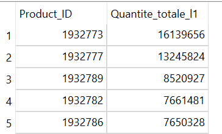
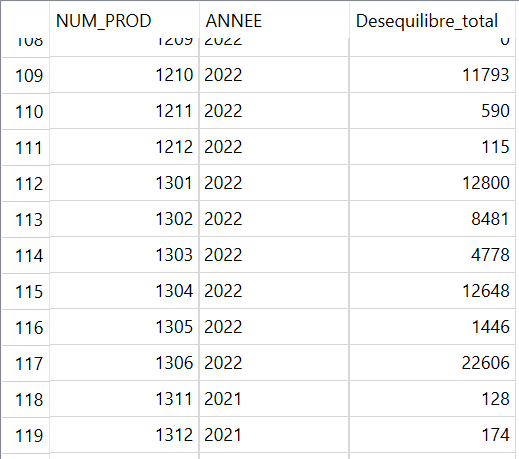

# Optimiser-la-capacite-d-une-ligne-de-production

Fiabiliser-et-analyser-des-donnees-de-production-avec-SQL-et-Power-Query
Mesure du déséquilibre de production des coffrets MiamBar

## Présentation du projet
MiamBar est une usine de barres de céréales organisée en deux lignes de production identiques : mélangeur → four → emballage en sachets → stérilisation → stock tampon → encartonnage → expédition. Depuis trois ans, l'usine vend des coffrets multi-variétés de 12 barres : 3 barres de chacune de 4 saveurs.
Chaque ligne ne dispose que d'un seul mélangeur : les saveurs sont produites l'une après l'autre, par batchs d'environ une heure, puis attendent dans le stock tampon avant d'être réunies à l'encartonnage. Au sein du service amélioration continue, ma mission est de fiabiliser les données de production, de chiffrer le déséquilibre de chaque production, puis de livrer au responsable de production un outil Excel lui permettant d'écarter lui-même les données douteuses.

## Problématique
Comment mesurer de façon fiable les barres perdues par déséquilibre sur les deux lignes de production, alors que l'enregistrement des données n'est pas encore maîtrisé ?
Un déséquilibre est constaté quand une saveur est moins produite que les autres (défaut qualité, arrêt machine...), elle limite le nombre de coffrets ; le surplus des trois autres ne peut plus être mis en coffret et il est jeté.

| Saveur | A | B | C | D | Barres jetées |
|---|---|---|---|---|---|
| Production | 100 000 | **99 000** | 100 000 | 100 000 | **3 000** |

## Objectifs métier
Chiffrer le déséquilibre par production et par ligne.
Repérer automatiquement les productions anormales (seuil fixé par le métier : 8 000 barres).
Permettre au responsable de production d'exclure des productions de son analyse, sans perdre ses choix à chaque mise à jour.
Préparer les données d'un futur tableau de bord.

## Jeu de données
Quatre extractions CSV du système de production, une table de planification et une table de production par ligne.

| Table | Rôle | Période | Enregistrements |
|---|---|---|--:|
| L1_Planif | Lots planifiés de la ligne 1 et leur numéro de production | avr. 2021 – mai 2022 | 663 |
| L1_Production | Batchs produits sur la ligne 1 (saveur, quantité, début, fin) | avr. 2021 – mai 2022 | 5 510 |
| L2_Planif | Lots planifiés de la ligne 2 | janv. 2020 – mai 2022 | 541 |
| L2_Production | Batchs produits sur la ligne 2 | janv. 2020 – mai 2022 | 12 631 |

Chaque batch est rattaché à un lot, lui-même rattaché à un numéro de production : batch → lot (LOT_PLANIF) → production (NUM_PROD)

### Les particularités des données
| Particularité | Conséquence | Réponse apportée |
|---|---|---|
| **Pas de modèle relationnel** : 4 tables retranscrites telles quelles, sans clé primaire ni étrangère | Les contrôles d'intégrité ne sont pas garantis par la base | Contrôles par requêtes : comptages, doublons, 19 batchs orphelins détectés et documentés |
| **Dates en texte** au format JJ/MM/AAAA HH:MM | Tri, `MIN`/`MAX` et fonctions de date faux dans SQLite ; heure perdue dans Excel | Colonnes en `DATETIME` et conversion au **format ISO** par `UPDATE` |
| **Le numéro de production revient chaque année** (numéro de semaine + incrément) | Deux productions d'années différentes fusionnées : faux coffrets « à 5 à 8 saveurs » | Clé métier **ligne + année + numéro de production** |
| **Une chaîne de fichiers** et non des requêtes isolées | La base doit alimenter Excel, puis un outil métier | Connexion **ODBC**, transformations **Power Query**, test de bout en bout |
| **Une saisie manuelle à conserver** | Une actualisation ne doit jamais effacer les choix du responsable | Tableau de saisie séparé, fusionné par Power Query |

## Outils
SQLite : moteur de la base, stockée dans un fichier .db.
Letos 4.0.1 (anciennement SQLiteStudio) : création des tables, import, requêtes.
Pilote SQLite ODBC : connexion entre la base et Excel.
Excel et Power Query : transformation des données et outil de modification manuelle.

## Méthodes utilisées
### SQL
CREATE TABLE, contraintes NOT NULL, typage (INTEGER, TEXT, DATETIME).
UPDATE avec substr et || pour convertir les dates au format ISO.
Jointures JOIN / LEFT JOIN entre production et planification.
UNION ALL et agrégation conditionnelle pour comparer les deux lignes.
strftime('%Y', …) pour extraire l'année de production.
Expressions communes WITH, vues CREATE VIEW, GROUP_CONCAT, HAVING.

### Power Query
Paramètre de dossier pour des chemins de fichiers transportables.
Fusions en jointure externe gauche, ajout de requêtes, regroupements successifs.
Colonnes calculées : déséquilibre, pourcentage, ATS (adhérence au planning), indicateur d'anomalie.
Chaîne de requêtes par références : les tables sources ne sont jamais modifiées.

## Démarche d'analyse
Nettoyer les quatre extractions et documenter les volumes.
Créer et alimenter la base SQLite, puis contrôler l'import (comptages, formats, orphelins).
Convertir les dates au format ISO.
Interroger la base : 12 questions métier, de la quantité par saveur jusqu'à la composition des coffrets.
Transformer dans Excel : une ligne par production, avec son déséquilibre et ses indicateurs.
Livrer l'outil au responsable de production : repérer, enquêter, exclure.
Analyser les valeurs aberrantes et en rechercher les causes.

## Analyses métier — exemples
```sql
-- Quantité totale produite par saveur sur la ligne 1
SELECT Product_ID, SUM(NB_Produits) AS Quantite_totale_l1
FROM L1_production
GROUP BY Product_ID
ORDER BY Quantite_totale_l1 DESC;
```


```sql
-- Quantité par production, année et saveur
CREATE VIEW qtes_produit_vw AS
SELECT NUM_PROD, strftime('%Y', L1_Planif.DATE_PLANIF) AS ANNEE,
       Product_ID, SUM(NB_Produits) AS Quantite_produits
FROM L1_Production
JOIN L1_Planif ON L1_Production.LOT_PLANIF = L1_Planif.IDENT_LOT
GROUP BY NUM_PROD, ANNEE, Product_ID;
-- Déséquilibre = somme des écarts à la saveur la moins produite
SELECT q.NUM_PROD, q.ANNEE,
       SUM(q.Quantite_produits - m.Quantite_minimum) AS Desequilibre_total
FROM qtes_produit_vw q
JOIN (SELECT NUM_PROD, ANNEE, MIN(Quantite_produits) AS Quantite_minimum
      FROM qtes_produit_vw GROUP BY NUM_PROD, ANNEE) m
  ON q.NUM_PROD = m.NUM_PROD AND q.ANNEE = m.ANNEE
GROUP BY q.NUM_PROD, q.ANNEE;
```


| Indicateur | Valeur |
|---|---|
| Productions analysées (L1 + L2) | **791** |
| Productions signalées comme anormales (déséquilibre > 8 000 barres) | **76**, soit environ 10 % |
| Batchs orphelins (sans lot de planification) | **19**, conservés et documentés |**

## Enseignements et limites

Avant d'analyser des chiffres, il faut s'assurer qu'ils sont justes : ici, les pertes les plus spectaculaires venaient de l'enregistrement des données, et non de la production.

Pistes d'amélioration : rattacher les lots à l'année de leur semaine de production, écarter automatiquement les lots d'un autre format, permettre l'exclusion au niveau du lot, construire un tableau de bord de suivi par ligne et par période.
